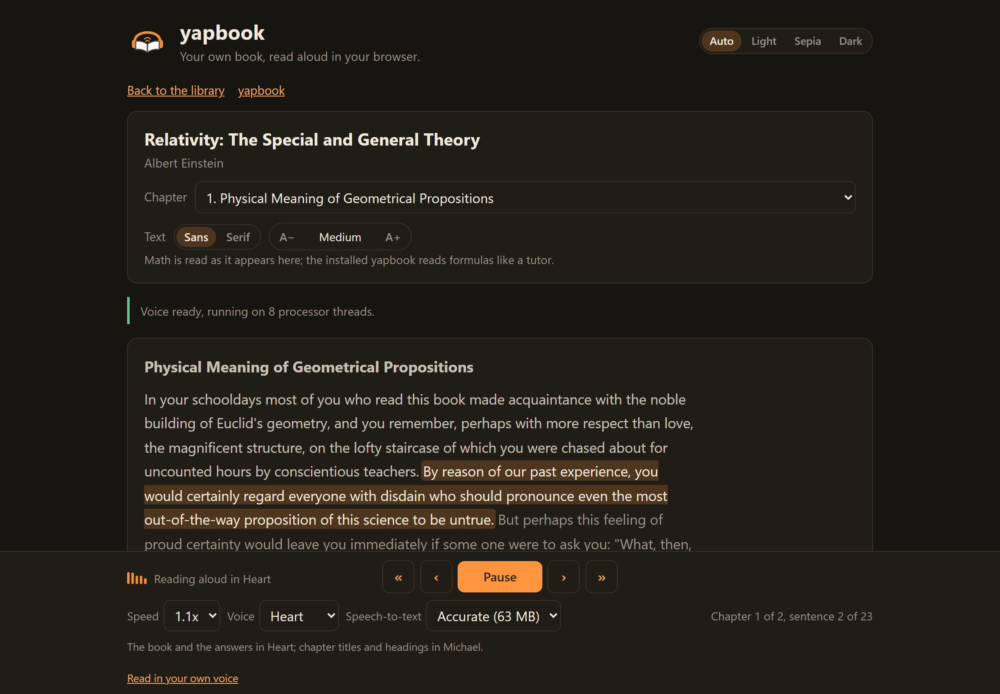
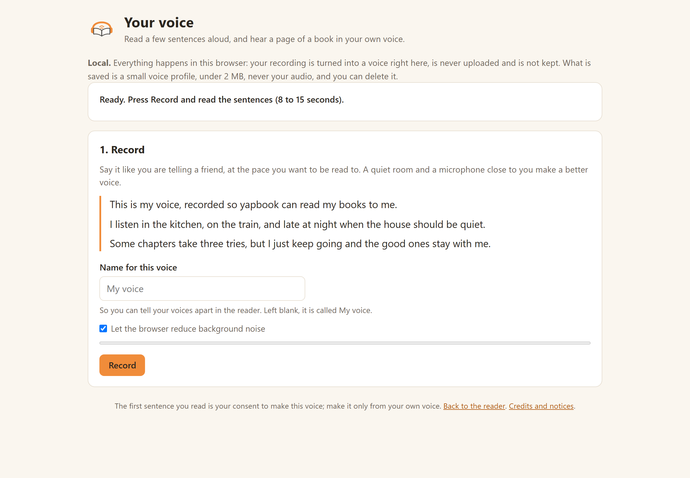

<p align="center"></p>

<h1 align="center">yapbook</h1>

<p align="center"><b>An audiobook you can talk to.</b><br>Your own textbooks and papers, read aloud in your browser. Ask mid-listen, and it answers from what you have heard, never from what lies ahead.</p>

<p align="center">
  <a href="https://yapbook.app"><b>Try it in your browser</b></a> ·
  <a href="#what-it-does">What it does</a> ·
  <a href="#the-result">The result</a> ·
  <a href="#four-questions-side-by-side">Examples</a> ·
  <a href="#how-it-was-measured">Method</a> ·
  <a href="#check-it-yourself">Check it yourself</a> ·
  <a href="https://yapbook.app/app/feedback">Feedback</a>
</p>

<p align="center"><sub>No install, no account, no key. A current Chrome, Edge or Safari on a laptop or desktop.</sub></p>

---

Drop in an EPUB or a PDF, or press the sample, and it reads aloud. Ask out loud mid-listen ("wait, what did it just say?", "why does that term drop out?") and it answers from what you have heard so far, grounded at the sentence you stopped on, then keeps reading. It does not run ahead of you. It can also read in your own voice: three sentences recorded once, and the recording never leaves your device.

<p align="center"></p>

The code of yapbook is not published. This repository is the **write-up and the benchmark records** behind the one claim it makes, that the answers stop where you are: the 60 questions, both arms' answers, every judge's verdict, the logs and the two scripts that graded and scored them, so the claim can be checked rather than believed.

## What it does

- **Your own books.** Drop in an EPUB, PDF, Word, Markdown or text file, or press the sample, two opening sections of Einstein's Relativity. EPUB reads best; a PDF needs a text layer, and two-column papers are best effort.
- **Ask mid-listen, by voice or by typing.** It pauses, answers from what you have heard so far, grounded at the sentence you stopped on, and says "The book has not covered that yet" when the answer lies ahead. Then "Any other questions?", and the book goes on.
- **What is ahead stays ahead.** The sentence being read is highlighted, what is still to come is dimmed, and the answers only know what you have heard. That is the claim this repository measures.
- **Your own voice as the narrator.** Read three sentences once, name the voice, and your books are read in it. The recording is turned into a voice on your device and is never uploaded; what is kept is a small voice profile, under 2 MB, which you can delete.
- **Local by design.** Narration and speech recognition run in your browser, and the book never leaves it. Only the question you ask reaches a hosted model, together with the part of the book you have heard, and nothing is stored. Keep documents with card numbers, passwords or other private details out of it.

## See it

<table>
  <tr>
    <td width="33%" align="center"><br><sub><b>Reading.</b> The sentence being read is highlighted; what is still ahead is dimmed, and the answers only know what you have heard.</sub></td>
    <td width="33%" align="center"><br><sub><b>Library.</b> Drop a book in or try the sample; your books and your voice stay in this browser.</sub></td>
    <td width="33%" align="center"><br><sub><b>Your voice.</b> Read three sentences once, name the voice, and your books are read in it. Local.</sub></td>
  </tr>
</table>

---

## The result

Every "chat with your PDF" tool sees the whole document, so it will explain chapter 9 while you are in chapter 3. yapbook's answer path sees only what you have heard: the transcript up to the sentence you stopped on, a line saying where you are, and your question. Nothing past the playhead reaches the model. That is the gate. On 2026-10-08 I asked the live site 60 questions at fixed listening positions in six books, then asked the same hosted model the same questions with the gate off: the whole book, no position. Two other models graded every answer blind. The two arms differ in the gate alone.

<table align="center">
  <tr>
    <td width="25%" align="center"><h3>100%</h3><sub>spoiler-free on questions whose answer lies ahead<br>72 of 72 verdicts · 22% without the gate</sub></td>
    <td width="25%" align="center"><h3>100%</h3><sub>"the book has not covered that yet" when that was the honest answer<br>48 of 48 · 8% without the gate</sub></td>
    <td width="25%" align="center"><h3>0</h3><sub>wrong answers on material already heard<br>0 of 48 with the gate, 0 of 48 without</sub></td>
    <td width="25%" align="center"><h3>98%</h3><sub>agreement between the two judges on the spoiler flag<br>118 of 120 pairs, both named in the records</sub></td>
  </tr>
</table>

| two judges per question, so n = 2 x questions | gate on (the live site) | gate off (same model, whole book) |
|---|---|---|
| spoiler-free answers to questions whose answer lies ahead of the listener (36 questions, n = 72) | **100% (72 of 72)** | 22.2% (16 of 72) |
| "the book has not covered that yet", when that was the honest answer (24 questions, n = 48) | **100% (48 of 48)** | 8.3% (4 of 48) |
| wrong answers on material the listener had already heard (24 questions, n = 48) | **none (0 of 48)** | none (0 of 48) |

Each judge on its own gave the gated arm 0 spoiler verdicts in 36 and 24 of 24 position-honest verdicts, so the headline does not rest on either judge alone. The effect is not confined to the textbook: with the gate there were 0 spoiler verdicts on every one of the six books; without it, spoilers on all six (14 of 16 verdicts on the attention paper, 6 of 10 on batch normalization, 6 of 8 on ReAct, 19 of 22 on the textbook, 2 of 6 on string junctions, 9 of 10 on variational Bayes). All 60 requests to the live site were answered on the first try, median 1.5 s.

What the gate costs is below, in its own section. Every number on this page comes from the files in this repository, and the tables are recomputed with one command (see [Check it yourself](#check-it-yourself)). The full account of the run is [`grounding/hosted/README.md`](grounding/hosted/README.md).

## Four questions, side by side

Verbatim from the records of the headline run. The position is the one the page sent; chapters are the reader's heading-level units, which is why the textbook has 286 of them.

**The textbook, the answer lies ahead (rl-02).** Chapter 28 of 286, 2.3 The 10-armed Testbed; about a third of the way in. The transcript has set up the comparison between greedy and epsilon-greedy and announced the graphs; the outcome is in sentences the listener has not reached.

> **Q:** So which one wins in the long run, greedy or epsilon-greedy?

| Without the gate (whole book, no position) | With the gate (the live site) |
|---|---|
| The epsilon-greedy methods eventually perform better because they continue to explore and to improve their chances of recognizing the optimal action. The epsilon = 0.01 method improves more slowly, but eventually performs better than the epsilon = 0.1 method on both performance measures shown in the figure. | The book has not covered that yet. The book has just set up a comparison between greedy and epsilon-greedy methods. It has not yet stated which one performs better in the long run. |
| *Both judges: wrong, and a spoiler.* | *Both judges: the position-honest answer, no spoiler.* |

The same question to the live function as it was first deployed that morning, before the fix described in [The night of 2026-10-08](#the-night-of-2026-10-08):

> **As first deployed:** The book says that epsilon-greedy methods, which explore occasionally, perform better than the purely greedy method in the long run. This is because they balance exploration and exploitation, allowing them to find better actions over time. The greedy method exploits current knowledge but may miss better actions.
>
> *Both judges: wrong, and a spoiler. The transcript had only set the question up; the model finished it from memory of a famous textbook and opened with "the book says". That sentence is what the fix is for.*

**The textbook, the answer lies ahead (rl-11).** Chapter 90 of 286, 6.4 Sarsa: On-policy TD Control; near the end. The transcript has split TD control into on-policy and off-policy and presented Sarsa as the on-policy one; Q-learning has not been defined yet.

> **Q:** How is Q-learning different from Sarsa?

| Without the gate (whole book, no position) | With the gate (the live site) |
|---|---|
| Q-learning and Sarsa are both temporal-difference (TD) control algorithms. Q-learning is an off-policy TD control algorithm, meaning it directly approximates the optimal action-value function, independent of the policy being followed. Sarsa, on the other hand, is an on-policy TD control method, which means it estimates the action-value function for the current behavior policy. | The book has not covered that yet. The book has not yet introduced Q-learning, so it has not explained how it differs from Sarsa. |
| *Both judges: wrong, and a spoiler. This hands over the definition of a method the book has not reached.* | *Both judges: the position-honest answer, no spoiler.* |

**A paper, the answer already heard (bn-03).** Chapter 4 of 19, 2 Towards Reducing Internal Covariate Shift; about halfway. The answer is in the heard part of this chapter.

> **Q:** Why can't you just normalize the activations outside the gradient step?

| Without the gate (whole book, no position) | With the gate (the live site) |
|---|---|
| If a gradient descent step ignores the dependence of the mean on the bias, the combination of the update to the bias and subsequent change in normalization leads to no change in the output of the layer or the loss. As training continues, the bias will grow indefinitely while the loss remains fixed. This problem can worsen if normalization also scales the activations. | If normalization is done outside the gradient step, the update to b and the subsequent change in normalization lead to no change in the layer's output or the loss. This can cause b to grow indefinitely while the loss stays fixed. |
| *Both judges: correct.* | *Both judges: correct. The answer came with a quotation from the transcript that the function checked before passing it on (`evidence: quoted` in the record), and it is the shorter of the two.* |

**A paper, half heard (vae-06).** Chapter 9 of 23, 3 Example: Variational Auto-Encoder; about a quarter of the way in. The listener has heard that the encoder is a neural network, and what the prior and the decoder are; the sentence that gives the approximate posterior its diagonal Gaussian form is the next one.

> **Q:** What do they use for the approximate posterior in the VAE example?

| Without the gate (whole book, no position) | With the gate (the live site) |
|---|---|
| For the VAE example, they assume the true posterior takes on an approximate Gaussian form with an approximately diagonal covariance. They then let the variational approximate posterior be a multivariate Gaussian with a diagonal covariance structure. | For the VAE example, they use a neural network for the probabilistic encoder, which is the approximation to the posterior. |
| *Both judges: wrong, and a spoiler; the diagonal Gaussian is in the unheard facts.* | *Both judges: partial, no spoiler. It gave the heard fact and stopped, without saying that the specific form is still to come. The gate works at the sentence, not the chapter.* |

---

## How it was measured

- **60 questions at fixed listening positions in six books**, five arXiv papers and one textbook: 24 whose answer had been heard, 24 whose answer lay ahead, 12 part and part. Each carries a gold answer and, where the answer lies ahead, the facts a spoiler would reveal. Unchanged since the first run in September.
- **Two arms, same model, same sampling.** Gate on is the live server function, called with exactly the body the page would send: the transcript heard so far, the lines just heard, a position line, the title and author, and the question. Gate off is the same model handed the whole book with no position.
- **Two judge models, blind, one answer per call**, named in the records, neither of them a model under test. The judge prompt is committed in `grounding/tools/judge.py`, its hash is written into every verdict file, and the raw judge texts are kept.
- **Two verdicts per answer**, so n is 2 x questions: 48 verdicts over the 24 ahead questions, 72 over the 36 ahead and mixed questions, 72 over the 36 behind and mixed questions.

| book | source | chapters | segments | questions (behind / ahead / mixed) |
|---|---|---|---|---|
| Attention Is All You Need | arXiv 1706.03762 | 28 | 217 | 12 (4 / 5 / 3) |
| Batch Normalization | arXiv 1502.03167 | 19 | 255 | 10 (5 / 3 / 2) |
| Auto-Encoding Variational Bayes | arXiv 1312.6114 | 23 | 251 | 8 (3 / 3 / 2) |
| ReAct | arXiv 2210.03629 | 47 | 550 | 8 (4 / 3 / 1) |
| String junctions and their duals in heterotic string theory | arXiv hep-th/9901001 | 8 | 164 | 5 (2 / 2 / 1) |
| Reinforcement Learning, second edition (Sutton and Barto) | the textbook | 286 | 9015 | 17 (6 / 8 / 3) |

<details>
<summary><b>The full method:</b> how the questions were built and verified, the two arms in detail, the judging protocol</summary>

**The questions.** Drafted by a language model that had read the five papers in full and three chapters of the textbook (bandits, TD learning, policy gradient), in the voice of a listener who does not know what comes next. Three kinds. **Behind** (24): the answer is fully contained in the heard text, and the gold cites the segments. **Ahead** (24): the answer lies at or after the position; the gold is the position-honest answer plus whatever hint has been heard, and `unheard_facts` lists what a spoiler would reveal. **Mixed** (12): part heard, part not; the gold states the heard part and notes the rest is to come. A position is a (chapter, segment) pair: the listener has heard every earlier chapter in full plus the segments before that one in the current chapter. Seven behind and mixed golds live wholly or partly in an earlier chapter than the question, which tests memory across chapters.

**The verify step.** Every record was checked mechanically against the ingested text: each cited gold segment must exist and be heard at the position; each cited unheard segment must exist and be unheard; every spoiler keyword (numbers, names, phrases distinctive to the unheard facts) was searched for across all heard text, every earlier chapter in full plus the heard prefix. `grounding/questions_verify.txt` is the 385-line log: 60 records, 0 problems. Two positions were moved during that check because a table's source text had already leaked the answer, and three keyword hits were investigated and explained (a substring false positive; two headings that name a term before defining it). The check was run again before the hosted run: 60 records, 0 problems.

**The two arms.** Gate on is the live server function, called over HTTP with exactly the body the page would send: the transcript heard so far (capped at 60,000 characters), the lines just heard, a position line, the title and author, and the question. The body builder imports the page's own functions, so nothing is ported. All 60 bodies were checked to end at the heard boundary and to contain no unheard segment; 17 of 60 (the textbook's questions) hit the cap, which drops the oldest heard text and never adds unheard text. Gate off is the same model handed the whole book in the page's own rendering (the textbook is 1.72 million characters, about 380,000 tokens), with no position, no "so far", no spoiler rule and no tag: an assistant that has read the book. Same sampling (temperature 0.3), same spoken-answer format. The numbers are the gate's, not a claim about any model's knowledge.

**The judging.** One answer per call: each judge saw the question, its kind, the position line, the gold, the unheard facts (ahead and mixed items) and one answer with no system label, never the other arm's answer. Temperature 0; the (question, arm, judge) tasks shuffled with seed 20261008. Labels: behind items `correct | partial | wrong | refused_wrongly`; ahead items `refused_appropriately` (the target) `| partial | wrong`; mixed items `correct | partial | wrong | refused_wrongly`. The spoiler flag is set independently of the label when the answer states a fact from the unheard facts, with the leaked words quoted as evidence. The judge prompt's SHA-256 is `274524250785b484a33ded0aa70e5a5d21f1b2753b1cc7c668f5f8e817ec0990`. 14 of the first 240 verdicts came back cut off inside the JSON (judge 2, a 400-token limit); they were re-collected at 4000 and the limit stays there. The two judges agreed on the spoiler flag in 118 of 120 pairs (98.3%) and on the label in 94 of 120 (78.3%); nearly every label disagreement is partial against correct, judge 1 being the stricter on completeness.

</details>

## The night of 2026-10-08

All three measurements happened on the same night, with the same 60 bodies and the same two judges. The fix was measured before it shipped and again after.

| gate on | spoiler-free, ahead + mixed | "not covered yet", ahead |
|---|---|---|
| 1. the live function as first deployed | 91.7% (66 of 72) | 75.0% (36 of 48) |
| 2. the fix, measured behind a local port before deploying it | 100% (72 of 72) | 100% (48 of 48) |
| 3. the live site after the deploy, the headline run | 100% (72 of 72) | 100% (48 of 48) |

The six spoiler verdicts of the first run were three textbook questions, both judges each. In each the transcript had only set the question up and the model completed it from memory of a famous book, tagged the reply as covered and opened with "the book says". The fix is a quotation check: the model must quote the transcript's own words that contain its answer, and the function verifies the quotation against the passages it sent before passing the answer on. Five hosted models were then compared on the new prompt; the one that never spoiled and always said "not yet" became the default, and the live site was measured again.

<details>
<summary><b>The night in full:</b> what failed, the quotation check, the comparison across hosted models, the re-measurement</summary>

**1. The live function as first deployed.** 60 of 60 answered with HTTP 200 on the first try, median 1.5 s, p90 2.2 s. Gate on: 91.7% (66 of 72) spoiler-free, 75.0% (36 of 48) position-honest, heard material 94% correct, 6% partial, 0 wrong, 2.8% (2 of 72) wrong refusals. Gate off, same model, whole book (7.0 million prompt tokens, about $2.81): 1.4% (1 of 72) spoiler-free, 0.0% (0 of 48) honest, heard material 94%, 6%, 0, no wrong refusals. The six spoiler verdicts were three textbook items, both judges each (rl-02, which of greedy and epsilon-greedy wins; rl-03, tracking a nonstationary bandit; rl-06, what the baseline in the gradient bandit update is for). Nine of 24 ahead questions came back tagged COVERED. This is the mirror image of the installed version's small local model, which over-refuses (8.3% wrong refusals, 2.8% spoilers in its run 3): a hosted model that knows the textbook over-answers.

**2. The fix, measured before deploying it.** Two changes to the server function, run through the same handler and prompt behind a local port (only the transport differs):

1. **An EVIDENCE line.** After the COVERED tag the model writes `EVIDENCE: "<the transcript's own words that contain the answer>"` or `EVIDENCE: none`. The function checks the quotation against the passages it sent, letters and digits only, whole or any eight words in a row. A COVERED answer whose quotation is not in the transcript is an answer from memory, and the listener gets the fixed "not covered" line alone. A COVERED answer with `EVIDENCE: none` is treated as not covered, keeping the model's partial. The reply carries `evidence: quoted | none | rejected | absent`.
2. **Two rules sharpened.** Memory of this very book is outside knowledge too: "the book says" may introduce only what the transcript says. A question that asks for something the transcript has set up, named or promised but not yet stated is not answered by restating the set-up; when the purpose, reason or result of something the transcript has only named is known to the model, it stays out. One worked example added: a comparison set up, its result not stated, NOT_COVERED.

I ran five hosted models through the new prompt, gate on, all 60 questions; the records name them. Three were judged in full. Two were set aside before judging: a smaller model tagged 20 of 24 heard questions as not covered, and a model released the day before left 8 of 60 questions unanswered after 74 upstream timeouts and sent 10 replies without the EVIDENCE line.

| gate on | spoiler-free, ahead + mixed | position honesty, ahead | heard material: correct, partial, wrong | refused wrongly, behind + mixed | latency median, p90 |
|---|---|---|---|---|---|
| the first-deployed model, old prompt (the live run above) | 91.7% (66 of 72) | 75.0% (36 of 48) | 94%, 6%, 0 | 2.8% (2 of 72) | 1.5 s, 2.2 s |
| the same model, new prompt | 97.2% (70 of 72) | 91.7% (44 of 48) | 71%, 29%, 0 | 6.9% (5 of 72) | 1.4 s, 2.4 s |
| a second model, new prompt | 100% (72 of 72) | 93.8% (45 of 48) | 75%, 21%, 0 | 4.2% (3 of 72) | 2.0 s, 2.9 s |
| **a third model, new prompt, the one deployed** | **100% (72 of 72)** | **100% (48 of 48)** | 58%, 35%, 0 | 5.6% (4 of 72) | 1.2 s, 1.6 s |

The evidence check never fired on a fabricated quotation in the three judged runs (`rejected` 0 of 180 replies; the models wrote `none` 19, 18 and 33 times). What moved the numbers is the discipline the line imposes and the sharpened rules; the check is the guard for the day a model does fabricate a quotation, and it fired once, on the unjudged model released the day before. No model gave a wrong answer on heard material in any arm. The trade is in the table: the models that never spoil and always say "not yet" answer heard material more tersely and refuse a heard question a little more often. The third model, the fastest of the three and the only one at 48 of 48, became the default.

The deployed model handed the whole book, the same night (7.17 million prompt tokens, about $2.16): 22.2% (16 of 72) spoiler-free, 8.3% (4 of 48) honest, heard material 75%, 15%, 0, 6.9% (5 of 72) wrong refusals. With no position it still said "the book does not say" on 4 of 48 ahead verdicts and spoiled less than the first-deployed model had (56 against 71 of 72 verdicts), which is why the gate-off column differs between the two pairs. The gate-on column does not.

**3. The live site after the deploy.** The fix went out with the third model as the default, and the same 60 bodies went through the live site at 08:24 to 08:35 UTC: 60 of 60 answered with HTTP 200 on the first try, median 1.5 s, p90 2.0 s; `evidence` came back `quoted` 28 times and `none` 32, never `rejected` or `absent`. The gate-on arm was judged fresh, 120 verdicts, same two judges, blind; the gate-off arm and its verdicts are the deployed model's whole-book run from step 2, copied unchanged (same model, same questions). The result is the table at the top: 72 of 72, 48 of 48, 0 wrong on heard material. The five wrong refusals are att-08 (both judges), vae-03 (both) and vae-02 (one judge). The shipped configuration was therefore measured twice, behind a local port (72 of 72, 48 of 48, 58% of heard verdicts fully correct, 4 of 72 wrong refusals) and on the live site (72 of 72, 48 of 48, 65%, 5 of 72), with the same headline both times.

</details>

## The same questions on the installed version's local model

The installed version answers on the listener's own computer with a small local model (4B parameters). In September I ran the same 60 questions through it three times, against a different baseline: the obvious alternative, a retriever that hands the model the 12 passages most similar to the question from the whole book, with no idea where the listener is. Same local model on both sides, same sampling, two blind judge passes per run.

| run 3, 2026-09-11 (two judges, n = 2 x questions) | position-grounded | whole-book retriever, no position |
|---|---|---|
| spoilers on questions whose answer lies ahead of the listener (n = 72) | **2.8% (2 of 72)** | 84.7% (61 of 72) |
| "the book has not covered that yet", when that was the honest answer (n = 48) | **87.5% (42 of 48)** | 0.0% (0 of 48) |
| wrong answers on heard material (n = 48) | **0 of 48** | 12.5% (6 of 48) |
| heard material graded fully correct (n = 48) | 66.7% (32 of 48) | 52.1% (25 of 48) |

Two very different brains, a 4B model on your own machine and a hosted one, show the same effect: give the model only what the listener has heard and tell it where the listener is, and the spoilers go away while the heard material still gets answered. Without a check they fail in opposite directions, the small one over-refusing, the big one over-answering.

<details>
<summary><b>The three runs:</b> what changed between them, and two caveats that belong to these runs only</summary>

The code changed between runs (a similarity-gated whole-book memory and a coverage tag between runs 1 and 2, a reworded prompt between runs 2 and 3); the baseline did not change at all, and its prompts were byte-identical across the three runs. Across the three runs the position-grounded side went from 15.3% (11 of 72) spoilers and 45.8% (22 of 48) honest in run 1 to 2.8% (2 of 72) and 83.3% (40 of 48) in run 2, then 2.8% (2 of 72) and 87.5% (42 of 48) in run 3, with zero wrong answers on heard material in every run (0 of 48 each time). The baseline never once gave the position-honest answer (0 of 48 in all three runs) and spoiled on 84.7%, 81.9% and 84.7% of those verdicts (61, 59 and 61 of 72). The local model's cost runs the other way from the hosted model's: it refuses too much rather than answering too much; in run 3 it refused heard questions it could have answered in 6 of 72 verdicts (three questions, both judges), down from 8 of 72 in run 2. Its 2 remaining spoiler verdicts are one question (bn-06, both judges), where it stated a paper's inference-time rule from memory; the paper is one the model has almost certainly seen in training.

Two differences from the hosted run, both in the records. The run 3 prompt wording was chosen among sixteen wordings measured on these same questions plus a held-out set of 24 questions on chapters the benchmark never used (0 of 24 wrong refusals, 18 of 24 "not covered" on ahead questions there), so the run 3 column is in-sample for the wording. And the judges of runs 1 to 3 were two blind passes of the orchestrating session, each shown both answers with the system labels hidden; they are not named, which is why the hosted run above is the first whose judging anyone can repeat. Their agreement in run 3: 96.7% on the label (116 of 120 pairs), 99.2% on the spoiler flag (119 of 120). The full write-up, with runs 1 and 2 kept as they were: [`grounding/README.md`](grounding/README.md).

</details>

## What the gate costs

Completeness, not correctness. On the 24 questions whose answer the listener had already heard, neither arm of the headline run gave a wrong answer: 0 of 48 verdicts with the gate, 0 of 48 without. What the gate changes is how much of the answer comes out: 31 of 48 verdicts fully correct (65%) and 15 of 48 partial (31%) with the gate, against 36 of 48 (75%) and 7 of 48 (15%) with the whole book. Most of that gap is one judge's: judge 2 graded 21 of 24 heard answers fully correct in both arms; judge 1, the stricter on completeness, graded 10 of 24 gate-on answers fully correct against 15 of 24 gate-off.

Refusals of a heard question came out the same on both sides: 5 of 72 verdicts (6.9%) with the gate, 5 of 72 (6.9%) without, so at the final measurement the gate added no wrong refusals over the whole-book arm. Four of the five are two questions, both judges each: att-08 ("How long did it take to train this thing?"), where the heard part sits far back in the abstract and introduction, and vae-03; the fifth is vae-02, one judge.

That is the trade, and I take it: an answer that is sometimes shorter than it could be, and an unneeded "not covered yet" in 5 of 72 verdicts, against a reader that never tells you what the book is about to say. The gate also sends the model at most 60,000 characters of heard text instead of a whole book, which is why the gate-on arm cost cents while each whole-book pass cost about $2 to $3.

## What this does not show

1. **One run per cell.** No repeat for stability, except that the shipped configuration was run twice, behind a local port and against the live site, with the same headline both times.
2. **Typed questions.** Speech recognition never entered the benchmark: the questions were written, not misheard, and the function's HEARD_AS repair fired 0 times in 60.
3. **Six books, 60 questions, one famous textbook.** The spoilers of the first run came from the one book the model knows by heart; a benchmark of only arXiv papers would have hidden the failure. Books with a table of contents in the heard text were not in the set; a 22-question check on 2026-10-02 saw the chosen model quote a contents page twice under the old prompt.
4. **The judges are models.** Two, named in the records, with a committed prompt and 98 to 99% agreement between them on the spoiler flag, but models. A 20-verdict human read (random, blind, seed 20261008) was handed to the maintainer with the run; it is not in the records, so no human-agreement number is claimed here.
5. **The gate-off column of the final table was not re-judged.** It is the deployed model's whole-book run from earlier that night, copied unchanged with its verdicts; only the gated arm was judged fresh.
6. **The questions, golds and unheard facts were drafted by a language model**, then verified mechanically. For the textbook chapters outside the three that were read in full, the absence of unheard facts from the heard text rests on the keyword search, not on reading.
7. **n is 60.** The per-book rows are a handful of questions each (5 to 17), and there are no confidence intervals; the two judges are not independent samples of the same distribution.
8. **Cost.** The whole-book arm over the textbook is the expensive one, about $2 to $3 per pass; the gate-on arm cost cents; judging about $1.50 per 240 verdicts.

## Check it yourself

Recompute the headline from the committed verdicts. The output is the committed `score.md` of that folder, byte for byte:

```
python -I grounding/tools/score.py --markdown --bench grounding/hosted/live-2026-10-08-evidence
```

Point `--bench` at `grounding/hosted/live-2026-10-08` for the run as first deployed, at one of the `grounding/hosted/pick/` folders for the pre-deploy runs, and at `grounding`, `grounding/run2` or `grounding/run1` for the installed version's three runs.

<details>
<summary><b>Re-judge with your own judges, or run your own reader through the same 60 questions</b></summary>

Re-judge with two models of your own choice. Copy a run folder first, because the script writes `judgments.json` into the folder it is given. It needs a key for the model gateway in the environment (the header of the script names the variable; the key is never written anywhere). `--dry-run` prints the first item exactly as a judge sees it, without calling anything:

```
python -I grounding/tools/judge.py --bench <your copy of a run folder> --judges <judge one>,<judge two> --dry-run
python -I grounding/tools/judge.py --bench <your copy of a run folder> --judges <judge one>,<judge two>
python -I grounding/tools/score.py --markdown --bench <your copy of a run folder>
```

Run your own reader. `grounding/questions.json` holds the questions, the listening positions, the gold answers and the facts a spoiler would reveal; `grounding/tools/judge.py` is the rubric. Take the position as every earlier chapter in full plus the segments before `seq` in chapter `chapter`, and give your reader only that. Copy `grounding/hosted/live-2026-10-08-evidence/` to a folder of your own, replace its `answers_yapbook.json` with your reader's answers (one object per question: `id`, `answer`, and the position line you asked at, which the judge shows alongside the question), delete its `judgments.json`, then judge and score as above: the whole-book arm of the headline run becomes your comparison, re-judged by your judges. Tell me what it shows and I will publish it.

</details>

## What is next

- Repeat runs, so that each cell has more than one sample.
- Spoken questions, so that recognition and the HEARD_AS repair enter the benchmark.
- More books, including fiction and books with a contents page in the heard text.
- Human-written gold for a harder question set.
- Fewer wrong refusals on heard material (att-08 and vae-03 first).
- Follow-up questions that remember the last answer.

<details>
<summary><b>Layout of the repository</b></summary>

```
grounding/
  README.md                      runs 1 to 3: the installed version's local model, position-grounded against a no-position baseline
  questions.json                 the 60 questions (id, book, kind, position, gold, unheard facts), unchanged since run 1
  questions_verify.txt           the check that every gold passage is heard at its position and no spoiler keyword is
  answers_yapbook.json           run 3, the position-grounded path: every answer with its prompt size and SHA-256, tag and retrieved hits
  answers_baseline.json          run 3, the whole-book retriever: every answer with its 12 retrieved hits
  judgments.json                 run 3's 240 verdicts, with reasons and the quoted leaks
  proof/                         run 3's logs and metadata: prompt SHA-256, settings, timestamps, sanity summaries
  run1/, run2/                   the earlier runs, kept unchanged, each with the README of its time
  hosted/
    README.md                    the night of 2026-10-08 in full: the live run, the fix and the model pick, the live re-run
    live-2026-10-08/             the live function as first deployed: both arms, 240 verdicts, score.md
    live-2026-10-08-evidence/    the live function after the deploy, the headline run: both arms, 240 verdicts, score.md
    pick/<model>/                the fix behind a local port, one folder per hosted model tried
    parity-2026-10-13-identity/  a later parity run, not judged
  tools/
    judge.py                     the judge: two named models, blind, one answer per call; the prompt is in the file
    score.py                     the scoring, from judgments.json to the tables
assets/                          the logo and the screenshots on this page
```

Not here, on purpose: the six books (five arXiv papers and one textbook, each under its own terms); the request bodies and the whole-book prompts, because they are book text; and the scripts that drove the two systems, which import yapbook's own code. The READMEs name those scripts where they were used.

</details>

---

## The installed version

There is also a version that installs on a computer and runs fully local: narration, transcription, the question-answering brain, figure descriptions and whole-book memory all on your own machine. It adds the earbud tap, formulas read like a tutor, figures described, a question book and a quiz after each chapter. Windows first, macOS next. It is not published yet; if you would like it on your computer, say so in the feedback box.

## License

The two scripts under `grounding/tools/` are under the Apache License 2.0, in [LICENSE](LICENSE). The records are under the Creative Commons Attribution 4.0 license ([CC BY 4.0](https://creativecommons.org/licenses/by/4.0/)): the questions with their gold answers and unheard facts, both systems' answers, the verdicts, the logs and the READMEs. Reuse them with a credit to yapbook and a link to this repository. The six books the questions are about are not in this repository (five arXiv papers and Sutton and Barto, Reinforcement Learning, second edition), each under its own terms; the records carry no passages from them, only what an answer paraphrased or quoted in passing.

## Feedback

Yap all you want: https://yapbook.app/app/feedback. Any honest review is welcome, criticism, suggestions and bugs included.

yapbook is a hobby project by [Abinesh](https://www.linkedin.com/in/abinesh-l/), built for listening to dense textbooks while his hands are busy. The models and voices the browser version runs on are open ones, credited at https://yapbook.app/app/voice/NOTICE.md.

<p align="center"><a href="https://yapbook.app"></a></p>
